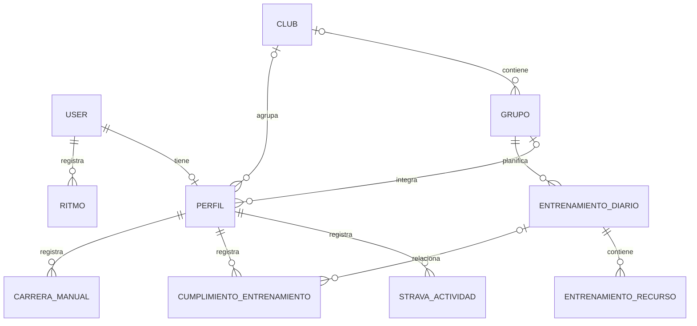

# Proyecto_integrado_grupo_Iterrunners

## Pruebas locales

Ejecuta `python manage.py test` desde la raíz del proyecto. Django usa SQLite en memoria y aplica todas las migraciones a esa base temporal, incluida `users.0044`. La base se descarta al finalizar y la ejecución predeterminada no usa Supabase.

Los demás comandos siguen usando la configuración habitual de PostgreSQL. Si defines `DJANGO_SETTINGS_MODULE` explícitamente, `manage.py` respeta ese valor también para las pruebas.

## Propuesta de Arquitectura - Cata (DEV)

### Arquitectura modular para Iterrunners

Se propone organizar Iterrunners mediante una arquitectura modular basada en Django, separando las responsabilidades principales del sistema para facilitar su mantenimiento y escalabilidad.

### Componentes propuestos

- **Autenticación y roles:** gestión de usuarios y permisos de Administrador, Profesor y Corredor.
- **Gestión de clubes y grupos:** administración de clubes deportivos, grupos de entrenamiento e integrantes.
- **Planificación deportiva:** creación y asignación de entrenamientos diarios y planes mensuales.
- **Seguimiento deportivo:** registro y visualización del cumplimiento de entrenamientos.
- **Integración externa:** conexión con Strava para sincronizar actividades deportivas.

### Justificación técnica

Esta propuesta favorece la **separación de responsabilidades**, la **mantenibilidad** y la **escalabilidad** del sistema. Permite incorporar nuevas funcionalidades sin afectar innecesariamente los demás componentes.

La arquitectura modular se plantea como una evolución de la estructura actual de Iterrunners.
## Segunda Propuesta - Cata (DEV)

### Mejora de seguridad y control de acceso en Iterrunners

Se propone fortalecer la seguridad de Iterrunners mediante un sistema de control de acceso basado en roles, utilizando las herramientas de autenticación y permisos de Django.

### Componentes propuestos

- **Autenticación de usuarios:** validar las credenciales antes de permitir el acceso a la plataforma.

- **Control de acceso por roles:** establecer permisos diferenciados para Administradores, Profesores y Corredores.

- **Protección de información:** restringir el acceso a datos personales y deportivos según los permisos del usuario.

- **Gestión de sesiones:** controlar el inicio y cierre de sesión para evitar accesos no autorizados.

- **Auditoría:** registrar acciones relevantes de administración para mejorar la trazabilidad del sistema.

### Justificación técnica

Esta propuesta busca fortalecer la **seguridad**, la **confidencialidad** y la **integridad** de la información.

El uso de mecanismos de autenticación y autorización de Django permite implementar controles de acceso de manera organizada y mantenible.

Además, contribuye al cumplimiento de los requerimientos de seguridad definidos para Iterrunners.

### Beneficios esperados

- Mayor protección de los datos de los corredores.
- Acceso a funcionalidades según el rol asignado.
- Reducción del riesgo de accesos no autorizados.
- Mejor trazabilidad de las acciones administrativas.
- Mayor confianza en la plataforma.

## Estructura de la base de datos

El sistema utiliza PostgreSQL y el ORM de Django para gestionar
la persistencia de datos.

Los modelos principales del sistema son:

- Club
- Grupo
- Perfil
- Ritmo
- EntrenamientoDiario
- EntrenamientoRecurso
- StravaActividad
- CumplimientoEntrenamiento
- CarreraManual

Estos modelos se encuentran definidos en users/models.py.

### Diagrama entidad-relación

El siguiente diagrama representa las relaciones principales
entre los modelos actuales de Iterrunners.

