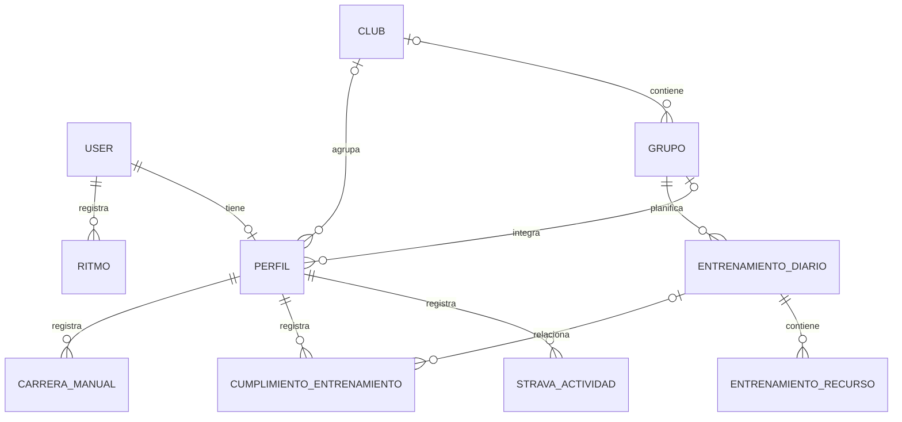

# Proyecto_integrado_grupo_Iterrunners

## Pruebas locales

Ejecuta `python manage.py test` desde la raíz del proyecto. Django usa SQLite en memoria y aplica todas las migraciones a esa base temporal, incluida `users.0044`. La base se descarta al finalizar y la ejecución predeterminada no usa Supabase.

Los demás comandos siguen usando la configuración habitual de PostgreSQL. Si defines `DJANGO_SETTINGS_MODULE` explícitamente, `manage.py` respeta ese valor también para las pruebas.

## Strava en la copia académica

1. En el `.env` local, usa los datos del Supabase académico en `DB_NAME`, `DB_USER`, `DB_PASSWORD`, `DB_HOST` y `DB_PORT`. Define `STRAVA_ENABLED=True`, `STRAVA_CLIENT_ID` y `STRAVA_CLIENT_SECRET` de la app API académica, y `STRAVA_REDIRECT_URI=http://localhost:8766/strava/callback/`. Las variables ya definidas en la terminal tienen prioridad sobre el archivo. El `.env` se mantiene fuera de Git.
2. Arranca Django desde la raíz del proyecto en una terminal de PowerShell y abre `http://localhost:8766/`. Usa `localhost` durante todo el flujo para conservar la sesión.

   ```powershell
   & .\.venv\Scripts\python.exe manage.py runserver localhost:8766 --settings=iterrunners.settings --noreload
   ```

3. Entra con un perfil de corredor académico. Pulsa **Conectar Strava**, inicia sesión con una cuenta habilitada en la app académica y concede permiso de lectura de actividades. Al volver a Inicio, abre **Actividad** para consultar la importación. Una app API de Strava en modo de un atleta solo admite a la cuenta que la registró.
4. Para probar la desvinculación, usa **Desconectar Strava** en el menú del perfil. Si Strava confirma la revocación, se limpian los tokens locales y las actividades guardadas se conservan. Si la revocación falla, puedes reintentar.

Para un despliegue académico en Render, configura las mismas variables con los recursos académicos y un callback HTTPS como `https://<servicio-academico>.onrender.com/strava/callback/`. Registra el dominio del servicio en la app API de Strava y configura `DEBUG=False`, una `SECRET_KEY` propia, `ALLOWED_HOSTS` y `CSRF_TRUSTED_ORIGINS` en Render. El script `render-build.sh` actual bloquea ese build de forma intencional y el despliegue se prepara por separado. Usa datos ficticios para las demostraciones donde un profesor consulta actividades de otro corredor.

## Recuperación de contraseña con Brevo

La aplicación usa la vista y el enlace de recuperación de Django. Para enviar correos reales, configura un remitente verificado en la cuenta académica de Brevo y define estas variables en el `.env` local o en el servicio académico de Render:

```dotenv
BREVO_EMAIL_ENABLED=True
BREVO_API_KEY=<clave-api-de-brevo>
DEFAULT_FROM_EMAIL=Iter Runners <remitente-verificado@ejemplo.cl>
```

Usa una clave de API de Brevo y mantenla fuera de Git. Reinicia Django, entra a **¿Olvidaste tu contraseña?** y solicita un enlace con el correo de una cuenta académica activa. En local, abre el correo en el mismo equipo que ejecuta Django y usa el mismo host y puerto al solicitar el enlace. En Render, los enlaces usan el dominio HTTPS del servicio académico.

Con el envío desactivado, Django muestra el correo en la consola local. Las pruebas usan correos en memoria y simulan el envío a Brevo.

## Propuesta de Arquitectura - Gaspar (DEV)

### Arquitectura por capas para Iterrunners

Se propone estructurar Iterrunners mediante una arquitectura por capas utilizando Django, separando la presentación, la lógica de negocio y el acceso a los datos para mejorar la organización y el mantenimiento del sistema.

### Capas propuestas

- **Capa de presentación:** interfaces HTML, plantillas Django y archivos CSS que permiten la interacción de Administradores, Profesores y Corredores.
- **Capa de lógica de negocio:** vistas, formularios y servicios encargados de gestionar clubes, grupos, planificaciones y entrenamientos.
- **Capa de acceso a datos:** modelos Django y ORM para consultar, registrar y actualizar la información del sistema.
- **Capa de integración externa:** comunicación con servicios como Strava mediante OAuth 2.0 y sincronización de actividades deportivas.

### Justificación técnica

Esta propuesta favorece la **separación de responsabilidades**, la **organización del código** y la **facilidad de mantenimiento**.

La arquitectura por capas permite identificar con mayor claridad las responsabilidades técnicas de cada parte del sistema y facilita la implementación de pruebas y futuras mejoras.

Esta propuesta representa una posible reorganización de la arquitectura actual de Iterrunners.

## Propuesta de Arquitectura - Cata (DEV)

### Arquitectura modular para Iterrunners

Se propone organizar Iterrunners mediante una arquitectura modular basada en Django, separando las responsabilidades principales del sistema para facilitar su mantenimiento y escalabilidad.

### Componentes propuestos

- **Autenticación y roles:** gestión de usuarios y permisos de Administrador, Profesor y Corredor.
- **Gestión de clubes y grupos:** administración de clubes deportivos, grupos de entrenamiento e integrantes.
- **Planificación deportiva:** creación y asignación de entrenamientos diarios y planes mensuales.
- **Seguimiento deportivo:** registro y visualización del cumplimiento de entrenamientos.
- **Integración externa:** conexión con Strava para sincronizar actividades deportivas.

### Justificación técnica

Esta propuesta favorece la **separación de responsabilidades**, la **mantenibilidad** y la **escalabilidad** del sistema. Permite incorporar nuevas funcionalidades sin afectar innecesariamente los demás componentes.

La arquitectura modular se plantea como una evolución de la estructura actual de Iterrunners.
## Segunda Propuesta - Cata (DEV)

### Mejora de seguridad y control de acceso en Iterrunners

Se propone fortalecer la seguridad de Iterrunners mediante un sistema de control de acceso basado en roles, utilizando las herramientas de autenticación y permisos de Django.

### Componentes propuestos

- **Autenticación de usuarios:** validar las credenciales antes de permitir el acceso a la plataforma.

- **Control de acceso por roles:** establecer permisos diferenciados para Administradores, Profesores y Corredores.

- **Protección de información:** restringir el acceso a datos personales y deportivos según los permisos del usuario.

- **Gestión de sesiones:** controlar el inicio y cierre de sesión para evitar accesos no autorizados.

- **Auditoría:** registrar acciones relevantes de administración para mejorar la trazabilidad del sistema.

### Justificación técnica

Esta propuesta busca fortalecer la **seguridad**, la **confidencialidad** y la **integridad** de la información.

El uso de mecanismos de autenticación y autorización de Django permite implementar controles de acceso de manera organizada y mantenible.

Además, contribuye al cumplimiento de los requerimientos de seguridad definidos para Iterrunners.

### Beneficios esperados

- Mayor protección de los datos de los corredores.
- Acceso a funcionalidades según el rol asignado.
- Reducción del riesgo de accesos no autorizados.
- Mejor trazabilidad de las acciones administrativas.
- Mayor confianza en la plataforma.


## Estructura de la base de datos

El sistema utiliza PostgreSQL y el ORM de Django para gestionar
la persistencia de datos.

Los modelos principales del sistema son:

- Club
- Grupo
- Perfil
- Ritmo
- EntrenamientoDiario
- EntrenamientoRecurso
- StravaActividad
- CumplimientoEntrenamiento
- CarreraManual

Estos modelos se encuentran definidos en users/models.py.

### Diagrama entidad-relación

El siguiente diagrama representa las relaciones principales
entre los modelos actuales de Iterrunners.


